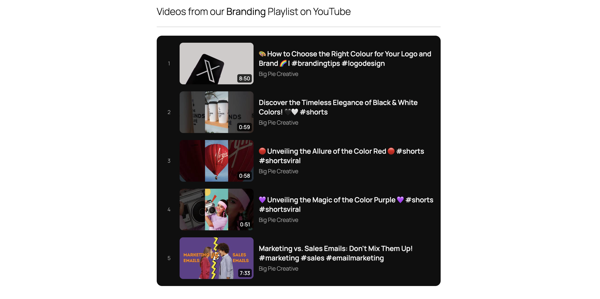

# Playlist List Block for YouTube

A tiny Gutenberg block that displays a YouTube playlist as a clean, numbered list: thumbnail, title, channel and duration. Enter the playlist ID and you're done.

 

## Features

- Live editor preview (rendered by the same PHP as the front end)
- Paste a playlist ID **or** the full playlist URL
- Dark (default) and light block styles
- Duration, UPCOMING and LIVE badges
- Every row links to the video inside the playlist
- Cached for 1 hour (filter: plb_cache_ttl)
- No build step, no npm, no third-party libraries

## Requirements

- WordPress 6.3+
- PHP 7.4+
- A free YouTube Data API v3 key

## Installation

1. Download playlist-list-block.zip from the Releases page.
2. In WordPress: Plugins > Add New > Upload Plugin, then activate.
3. Go to Settings > YouTube Playlist and paste your API key.
4. Add the "YouTube Playlist List" block and enter a playlist ID.

### Getting an API key

1. Open the Google Cloud console and create (or pick) a project.
2. Enable "YouTube Data API v3".
3. Create an API key under Credentials. Restrict it to the YouTube Data API.

### Keeping the key out of the database (optional)

Add this to wp-config.php:

    define( 'PLB_API_KEY', 'your-api-key' );

## Quota

A playlist request costs 1 unit; showing durations adds 1 more. With the default 10,000 units/day and 1-hour caching this is rarely a concern.

## Privacy and YouTube terms

The server sends the playlist ID and your API key to the YouTube Data API. Visitors' browsers load thumbnails from i.ytimg.com. By using this plugin you agree to the [YouTube Terms of Service](https://www.youtube.com/t/terms) and the [Google Privacy Policy](https://policies.google.com/privacy).

## Development

There is no build step. Edit the files and reload.

- playlist-list-block.php: registration, API calls, caching, rendering, settings page
- block.json: block metadata
- assets/editor.js: editor UI (plain JS, no JSX)
- assets/style.css: front-end and editor styles

### Releasing

1. Bump the version in playlist-list-block.php, readme.txt and README.md.
2. Commit, then tag: git tag v1.0.0 && git push --tags
3. The GitHub Action builds playlist-list-block.zip (dev files excluded via .gitattributes) and attaches it to the release.

## License

GPL-2.0-or-later. See LICENSE.
